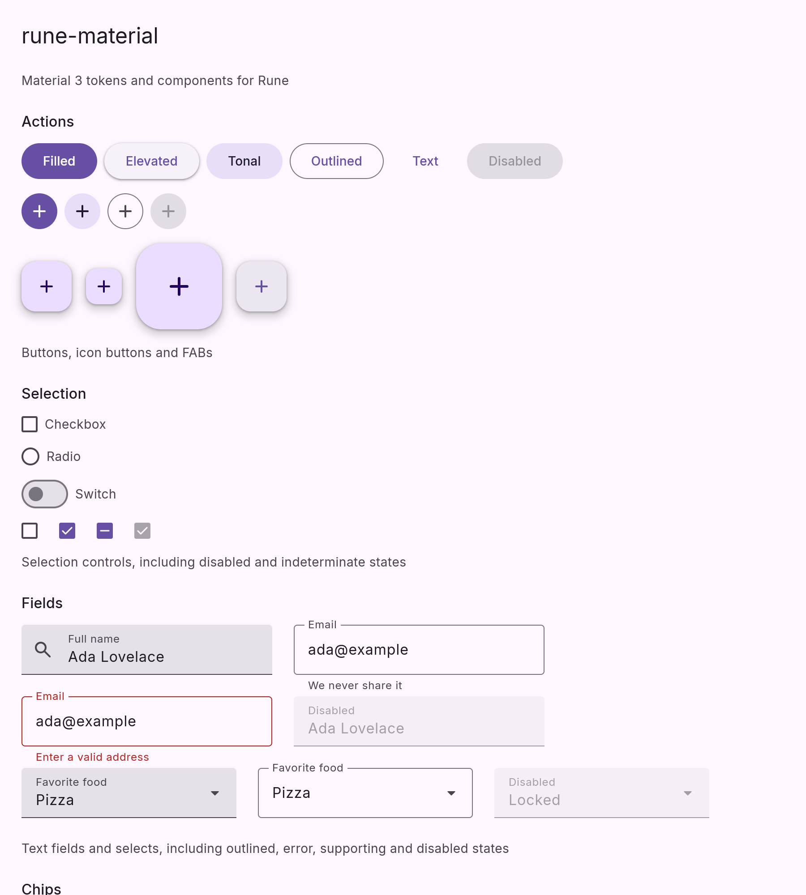

# rune-material

Material 3 tokens and components for [Rune](https://github.com/anomalyco/rune),
pinned to Rune rev `0796df5fa269b85d4fc04786bbd37f7349eb6606`.
Token values are exact from `material-web` v0.192 (`vendor/` is reference-only
and git-excluded).

**Pre-release / Git and Nix only.** Linux is the initial supported target;
Nix outputs cover x86_64 and aarch64. macOS, Windows and web are not validated
release targets. Rune APIs and this crate's public API may change.



## Get started

Nix with flakes enabled is the recommended reproducible build path:

```sh
git clone https://github.com/fusion44/rune-material.git
cd rune-material
nix run .#gallery
```

These public-clone commands become available after the prepared commits are
pushed; see [release gates](RELEASE.md). No crates.io release is planned.
For development use `devenv shell` (or `nix develop`), `just test`, and
`just check` for formatting, Clippy, tests and all release packages.
`devenv test` checks formatting and runs the application/component tests.

## Use

```rust
use rune_material::{Button, ButtonVariant, Theme};

let theme = Theme::light();
Button::new("Save")
    .variant(ButtonVariant::Filled)
    .key("save")
    .build(&theme)
    .on_press(|s: &mut State| s.saved = true)
```

Rules:

- Components are builders ending in `.build(&theme) -> El`. They read only
  semantic `Theme` tokens — no raw colours, sizes, radii or fonts.
- Builders do not own app handlers. Attach `.on_press(...)`, `.on_edit(...)`,
  `.on_drag(...)` to the returned `El` before or after assembly.
- `Theme::light()` / `Theme::dark()` are the M3 baselines;
  `Theme::with_scheme(scheme, dark)` applies a custom `ColorScheme`
  (e.g. from `rune_material::dms`).

## Layout

- `src/color.rs`, `typography.rs`, `shape.rs`, `elevation.rs`, `state.rs`,
  `motion.rs` — exact M3 token values.
- `src/components/` — `Button`, `IconButton`, `Fab`, `Checkbox`, `Radio`,
  `Switch`, `TextField`, `Select`, `Chip`/`ChipSet`, `Card`, `Divider`,
  `Badge`, `Progress` (linear), `Tab`/`Tabs`, `List`/`ListItem`,
  `Menu`/`MenuItem`, `Slider`, `Dialog`/`Scrim`, `Snackbar`.
- `src/dms.rs` — map DMS `dms-colors.json` palettes into `ColorScheme`/`Theme`.
- `examples/gallery` — widget gallery (`--snap out.png --scene light|dark|dialog|menu`).
- `examples/dms_theme` — DMS-reactive demo (watches the palette file).
- `examples/calculator` — Material calculator (`--scene light|dark|sum`).

## Desktop font size and zoom

The gallery and Dux theme demo follow Dux Modular Shell's global
`fontScale` from `$XDG_CACHE_HOME/dms/dms-typography.json` (default:
`~/.cache/dms/dms-typography.json`). Changes apply live; missing settings
fall back to 100%. `DMS_TYPOGRAPHY_FILE` overrides the path for testing.
The legacy `dms` path remains the shell's published location after its rename.

- **Ctrl++** or **Ctrl+=**: zoom in by 10%.
- **Ctrl+-**: zoom out by 10%.
- **Ctrl+0**: reset to the desktop scale.

Zoom is session-local (50–200%) and multiplies the desktop scale; it never
writes shell settings. Text sizes, line heights and letter spacing scale
together. Applications can opt in using the exported `FontScale` helper;
baseline tokens are not changed by reading desktop settings.
The reusable `Theme::light()` / `Theme::dark()` defaults remain exact M3 tokens.

## Icons

All bundled icons use Google's official **Material Symbols Rounded** SVGs
(weight 400, optical size 24), shared by the components, gallery and consumers.
Folders are filled; file categories have distinct symbols. Icons remain
theme-colored and are embedded at compile time, with no font dependency.

Use the exported constants, for example `IconButton::new(&rune_material::ADD,
"Add")`. Components still accept custom `&'static rune::Icon` values.
The vendored subset, Apache-2.0 license, pinned source revision and update
instructions are in [`assets/material-symbols/`](assets/material-symbols/README.md).

## Ink ripples

Pressables (`Button`, `IconButton`, `Fab`, `Chip`, `Tab`, `ListItem`,
`MenuItem`, `SnackbarAction`) opt into the Material ink ripple with
`.ink(&ink)`, sharing the app's `rune_material::Ink` store:

```rust
struct State { ink: Ink, /* ... */ }

Button::new("Save")
    .key("save") // ripples match by element key
    .ink(&s.ink)
    .build(&theme)
    .on_press(|s: &mut State| s.save())
```

The builder captures the pointer-down origin via `on_drag` (and the
release the same way) and paints one keyed circle per live press in the
variant's pressed state-layer colour, clipped to the control's shape and
under its content. Enter grows half to full size at full ink opacity over
the settle spring (kit rules forbid starting smaller;
`Transition::scale`'s built-in fade-in is disabled so the spread reads);
the ripple stays mounted while held and fades in place once released,
following Rune's own click-ripple pattern. The wash layer is
transition-free so circles never ride its default fade. The motion system
drives both; the app only drains expiries from its poll:

```rust
fn poll(s: &mut State, now: f64, _: &mut rune::Tx) -> bool {
    s.ink.poll(now)
}
```

Pressables with `.ink()`: `Button`, `IconButton`, `Fab`, `Chip`, `Tab`,
`ListItem`, `MenuItem`, `SnackbarAction`, `Card` (attach an app `on_press`
for the card to actually do something). Ripples clip to their host shape,
including the 40 pt circle of an `IconButton`; focus rings remain outside
the clip. No ink on `Slider` (its API is app-attached `on_drag`), text fields,
selects, or selection controls: M3 gives those a state layer but no ink
spread. Limits: needs `.key(..)`; occupies the element's `on_drag` slot (so `Slider`,
whose API is app-attached `on_drag`, has none); keyboard activation shows no
ripple (focus ring + state layer still respond); without a wired `poll`,
ripples linger (capped). The gallery's `--scene ink` snapshot shows a live
ripple on the filled button.

## Text fields

`TextField::new(&state.edit, ...)` borrows the app's `TextEdit`; route edits
with `.on_edit(|s| &mut s.edit)`. Each live input needs its **own**
`TextEdit` model — even a read-only error/disabled twin with the same text.
The framework recognises a field across rebuilds by its model, so two inputs
sharing one model flap focus between them after every edit (the twin counts
as newly requested and steals it).

## Overlay placement

Mount overlays after the scrollable content at the window root. Stretch a
scrim out of flow so it cannot shrink the content's viewport:

```rust
use rune_material::Scrim;

Scrim::new()
    .backdrop_blur(8.0) // optional frosted background; default is no blur
    .build(&theme)
    .pin(Some(0.0), Some(0.0), Some(0.0), Some(0.0));
```

Anchor menus to the trigger's key with
`.anchored("open-menu", rune::Side::Bottom, rune::Align::Start, 8.0)` rather
than fixed screen coordinates. Rune follows scrolling/resizing and flips the
menu when it needs room. Modal focus and dismissal
remain attached to the menu/dialog panel, above the backdrop.

## Applications

The file manager formerly developed as `examples/files` / `filer` is now
**[Codringher](https://github.com/fusion44/codringher)**, in its own repository.
Its application state, filesystem/image dependencies, tests, packaging and
NixOS module live there. This crate retains reusable components, the shared
Material Symbols catalog and typography/theme integration; it has no dependency
on Codringher.

For local Cargo development, consumers use a sibling dependency:

```toml
[dependencies]
rune-material = { path = "../rune-material" }
```

Both projects must use the same pinned Rune revision. Consumer workspace roots
must also copy the `[patch.crates-io]` entries from this crate's `Cargo.toml`:
Cargo does not inherit a dependency's workspace patches, and Rune requires its
patched text/platform crates from the same revision. The `tooling` feature keeps
headless snapshot commands available in release builds.

The public library remote is `https://github.com/fusion44/rune-material`.
Once the reviewed commit is published, Git consumers should replace the optional
sibling dependency with that URL and a full immutable `rev`; do not follow a
floating branch. Codringher's hand-off is tracked in [RELEASE.md](RELEASE.md).

## DMS theme integration

DMS publishes no palette IPC event; the palette lives at
`$XDG_CACHE_HOME/dms/dms-colors.json` (top-level `mode` plus
`colors.light`/`colors.dark` keyed by M3 snake-case roles), written atomically
via `.tmp` + rename. `rune_material::dms`:

- `palette_path()` honours `DMS_COLORS_FILE`, then `XDG_CACHE_HOME`, then
  `$HOME/.cache`.
- `theme_from_json(bytes, dark)` honours top-level `mode` unless `dark`
  overrides it; missing roles fall back to the baseline scheme.
- The example apps watch the file on a background thread (200 ms byte
  comparison, content-hash debounce) and wake Rune through `AppSpec::setup`'s
  `Waker`; `AppSpec::poll` drains the channel and returns whether the theme
  changed. No dependency on DMS in the library itself.

## Build and test

Build with Nix using your configured local or remote builders:

```sh
# Stage newly created source files: Nix reads the Git working tree.
nix build .#library .#gallery .#dms-theme .#calculator
nix build .#checks.x86_64-linux.tests --no-link --print-build-logs
```

`nix run .` or `just run` opens the gallery. Named apps/packages are `gallery`,
`calculator` and `dms-theme`; `packages.library` builds the crate with all demos.
Checks and development shells are provided for `x86_64-linux` and `aarch64-linux`.
`lib.source` exports the filtered Rust/SVG source for downstream Nix builds.

Snapshots: `just snaps`, or `./result/bin/gallery --snap light.png --scene light`
after building `.#gallery` into `result` (similarly for the other demos).

There is intentionally no NixOS module for a Rust UI library: it needs no
system service or global configuration. Codringher owns desktop installation
and its opt-in file-manager MIME association.

## License

Apache-2.0; see [LICENSE](LICENSE). Official Google Material Symbols retain
their Apache-2.0 license and attribution in `assets/material-symbols/`.
See [dependency/license policy](DEPENDENCIES.md), [security reporting](SECURITY.md),
and [changelog](CHANGELOG.md).

## Known limitations

- Outlined fields/selects fake Material's outline notch with a padded
  `surface`-filled floating label; Rune has no border-notch primitive.
- `Progress` is linear only; circular progress is not implemented.
- Tabs use `.checked(selected)`; Rune has no `aria-selected`.
- Cards default to zero content padding so media can bleed.
- The DMS watcher polls bytes every 200 ms rather than using inotify, to avoid
  an extra dependency; latency is bounded by the poll interval.
- Calculator keys say `Del`, not `⌫`: the Inter slot has no U+232B glyph.
- QML calculator verified by inspection against DMS `Theme.qml`, not executed
  (it must run inside the live shell).
